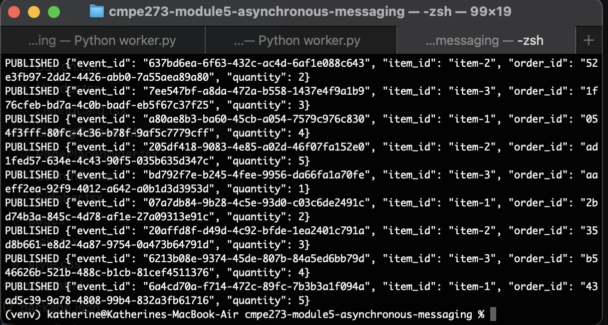
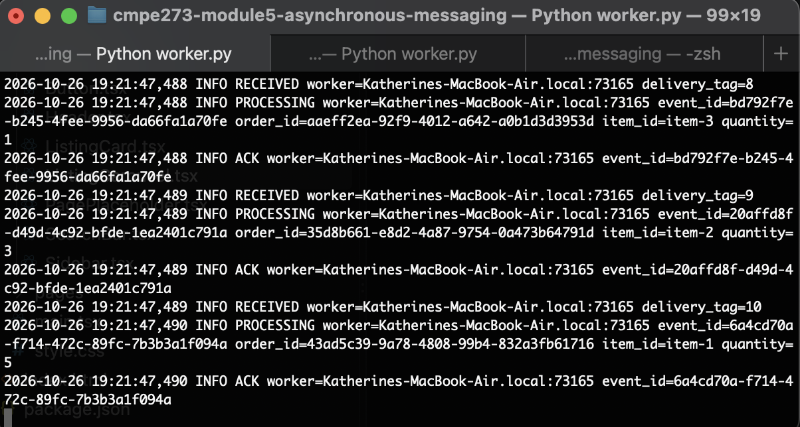
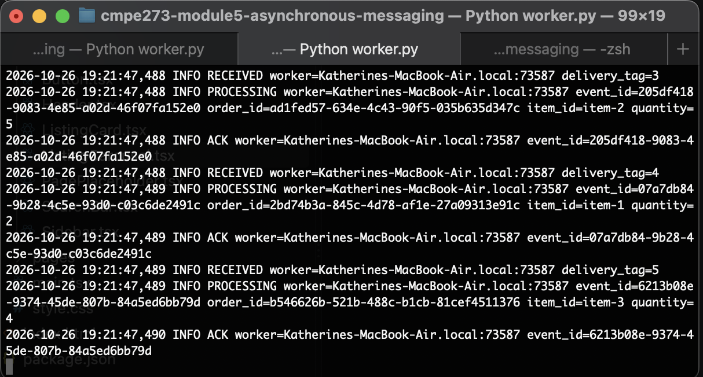
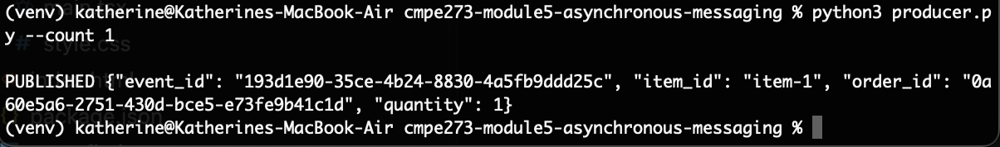
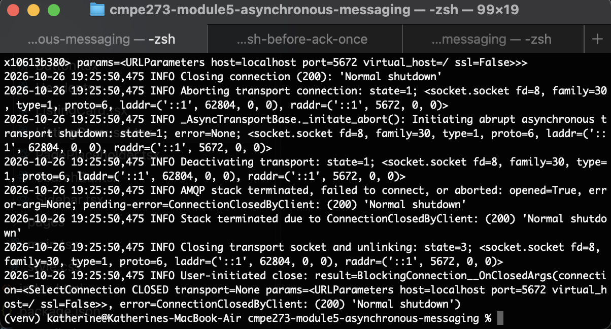
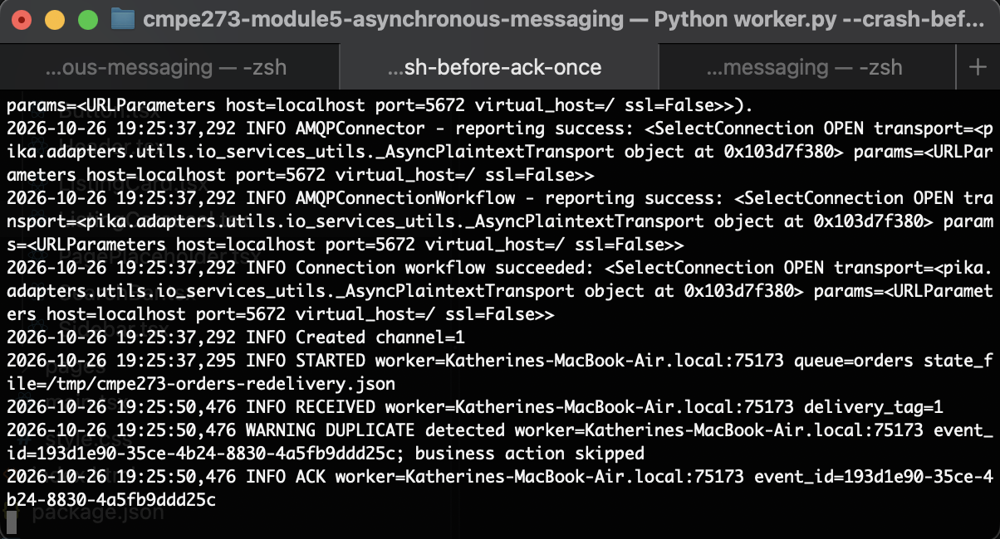

# cmpe-273-module5-asynchronous-messaging

## Architecture Diagram
flowchart LR
    P[Order Producer<br/>independent process] -->|publish order events| Q[(RabbitMQ<br/>durable orders queue)]

    Q -->|deliver message| W1[Order Worker 1<br/>independent process]
    Q -->|deliver message| W2[Order Worker 2<br/>independent process]

    W1 <-->|check / record event_id<br/>file lock| S[(Shared JSON state file)]
    W2 <-->|check / record event_id<br/>file lock| S

    W1 -->|ACK after processing| Q
    W2 -->|ACK after processing or duplicate check| Q

    W1 -. "connection closes before ACK" .-> Q
    Q -. "redeliver unACKed message" .-> W2

## Instructions
From this directory, start the broker:

```sh
docker compose up -d --wait
```

RabbitMQ's AMQP port is `5672`; its management UI is at `http://localhost:15672` (default credentials: `guest` / `guest`). Install the Python dependency:

```sh
python3 -m venv venv
source venv/bin/activate
pip install -r requirements.txt
```

Open two terminals in this directory and start one worker in each. Use the same state file for both:

```sh
ORDER_STATE_FILE=/tmp/cmpe273-orders-competing.json python3 worker.py
```

Publish several orders from a third terminal:

```sh
python3 producer.py --count 10 # replace the count argument with however many messages you wish to send
```

## Successful message processing

Producer publishing 10 messages

## Competing consumers


Both consumers acknowledging the messages with a different event id for each

## Failure and redelivery

Producer sending only one message


First receiver receives the message and shuts down before acknowledging, so the message is sent back to the queue after the consumer queue gets closed

## Duplicate handling

After closing queue of first receiver, second receiver receives the message when the unacknowledged delivery returns to the queue. The duplicate is logged and business action is skipped when the message is acknowledged.

## Reflection
A message can be delivered more than once if a consumer on a queue does not send an acknowledgement of a receipt after receiving a message, which sends the message back to the queue and out to another consumer. This means the message is delivered to more than one consumer. Idempotent handling helps in situations like this because even when the message is sent multiple times, the business action does not reoccur if duplication handling is done. This means even if a message is sent multiple times in case of failure, the expected result for an end user remains reliable, demonstrating idempotency.
